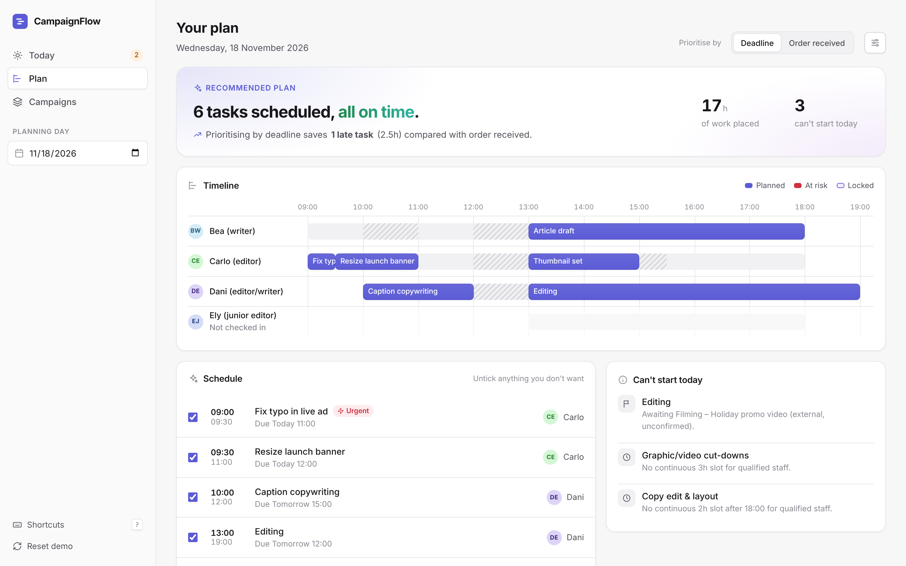

# CampaignFlow

Daily production-planning support for a small marketing agency.
MSYS 30 (Data Structures and Algorithms) final project — Isabello & Navarro.

CampaignFlow helps an account manager decide **which ready writing/editing task
each person should do next today**. It respects task dependencies, skills,
working hours, meetings and accepted commitments. External steps (filming,
client approvals) are treated as *gates* that the manager confirms. The tool
never assumes an approval will arrive on time.

## Run it

```bash
pip install -r requirements.txt
python -m campaignflow.web.app          # http://127.0.0.1:5000
python -m pytest -q                     # 217 tests
python -m campaignflow.bench.run        # benchmarks -> docs/results/
```

The first launch seeds a **synthetic** demo agency into `data/state.json`
(git-ignored). Use "reset demo" in the footer to restore it.



## Interface

- **Today**: a "needs your attention" inbox (gates ready to confirm, unconfirmed staff, missing estimates), headline numbers, and campaign groups with progress bars. It also has filter chips, instant search, and a bulk-action bar for checked rows.
- **Plan**: a Gantt timeline per person, the reason each skipped task wasn't scheduled, and an insight card comparing the deadline-first rule with the entry-order baseline. You can accept proposals and lock them as commitments.
- **Campaigns**: template cards that show each campaign's steps, a team roster, and a task editor with a searchable prerequisite picker.
- Dark mode, mobile layout, toasts, a loading bar, and keyboard shortcuts (`1` `2` `3` to switch pages, `/` to search, `Esc` to clear, `?` for help). The app has no CDN dependency at runtime.
- **Motion**: a branded splash screen on first open, smooth page transitions, numbers that count up, timeline bars that grow in, a cursor spotlight on cards, and a small celebration when a plan is locked in. All motion respects the reduced-motion setting.

More screenshots are in [`docs/screenshots/`](docs/screenshots/).

## Trailer

[`docs/videos/campaignflow-trailer.mp4`](docs/videos/campaignflow-trailer.mp4) is a 1:56 product trailer at 1080p and 60 fps, with a voiceover and score. It covers the problem, the five features with animated algorithm explainers, and the measured impact. It is rendered entirely from code; see [`trailer/README.md`](trailer/README.md).

## Usability study kit

[`docs/usability/`](docs/usability/) has everything needed to run the three-person study from the proposal:
- `protocol.md`: consent script, counterbalanced order, four disruption cards, interpretation questions with an answer key, and an observer checklist.
- `scenario-A.md` and `scenario-B.md`: printable briefings for two matched scenarios. The app loads Scenario B with `variant=B` on reset.
- `results.csv` and `summarize.py`: the results sheet, and a script that turns it into a summary table for the report.

## Demo videos

`docs/videos/campaignflow-demo.mp4` is the full walkthrough (about 2 minutes 50 seconds). It joins these five clips:

| Clip | Shows |
|---|---|
| `01-daily-review.mp4` | Splash screen, Today page, confirming a gate, checking someone in, filters, search, bulk select |
| `02-plan-and-compare.mp4` | The recommended plan, the timeline, and switching to the entry-order rule, which makes the banner late |
| `03-lock-in.mp4` | Unticking a task, locking in the plan (confetti), and unlocking a commitment |
| `04-new-campaign.mp4` | Creating a campaign from a template, then a client requesting changes, which adds a revision round |
| `05-cycle-detection.mp4` | DFS rejecting a circular dependency and naming the exact loop |

To re-record them, start the app first, then run:

```bash
node scripts/record_demo.js
bash scripts/make_videos.sh
```

## Course components (Table 2 of the proposal)

| Component | Where | Complexity |
|---|---|---|
| **DS 1** Directed graph, adjacency lists (succ + pred) | `core/graph.py` | O(V+E) space |
| **DS 2** Min-heap priority queue, hand-written sift-up/down | `core/heap.py` | push/pop O(log n), heapify O(n) |
| **Algo 1** Iterative DFS cycle detection (white/gray/black) | `DiGraph.find_cycle` | O(V+E) time, O(V) space |
| **Algo 2** Greedy priority-based allocation (serial schedule generation) | `core/allocator.py` | O(n log n + e + n·s·w) |

n = tasks, e = dependency links, s = staff, w = free intervals per person.

Supporting pieces:
- `core/windows.py`: interval subtraction and earliest-fit search on sorted interval lists
- `core/policy.py`: the deadline rule and the entry-order baseline, which differ only in the heap key
- `core/invariants.py`: an independent hard-constraint checker
- `core/metrics.py`: summary metrics and replay with sampled "actual" durations

## Layout

```
campaignflow/
  core/        engine (pure Python, no dependencies)
  web/         Flask + HTMX UI, JSON store, campaign templates
  bench/       seeded workload generator + benchmark/comparison harness
tests/         unit, behavioural, randomized-invariant and route tests
docs/results/  benchmark CSVs, RESULTS.md, runtime.png
```

## Key design decisions

- **Upper estimates reserve capacity.** Schedules show what is feasible under those estimates, not promised finish times.
- **External gates never auto-release.** Dependent work waits for the manager to confirm the gate.
- **Same-day release (configurable, on by default).** An internal task can start after its prerequisite's *planned* finish on the same day. Turn it off to require completed work only, as in the original proposal.
- **Commitments are locked.** Replanning works around them. If a new meeting overlaps a commitment, planning stops with a conflict message until the manager reviews it.
- **Stale recommendations can't be accepted.** Every edit bumps a version number. Accepting a recommendation built on old inputs is refused.
- **Revisions add new tasks and never reopen old ones.** "Changes requested" closes the review gate and adds a revision task plus a new review gate, so a revision loop can never create a cycle.
- **Same allocator for both policies.** The baseline uses the same allocator, feasibility checks and tie-breaks; only the heap key differs, so any difference in results comes from the ordering rule.
- **Pruning (results unchanged, tested at every size).** Staff whose longest free block is shorter than the task are skipped in O(1). The scan also stops at the first person, in tie-break order, who can start at the earliest possible time.

## Future improvements

- A per-skill index of staff ordered by next free time would cut the n·s window scan at large staff counts.
- Multi-person tasks and equipment bookings.
- Splitting a task across non-contiguous windows.
- Learning effort ranges from past actual durations.
